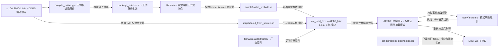

# ugreen-ax900

UGREEN AX900 / AICSemi AIC8800D80 USB Wi-Fi 网卡的 Linux 驱动整理仓库。

工程标准入口：`harness/docs/workspace/standards/linux-driver/linux-driver-golden-path.md`。

## 架构拓扑



本仓库提供两种安装方式：

- 直接安装 release 中的预编译驱动包：当前正式包目标为 Ubuntu 24.04 / `7.0.0-38-generic` / `x86_64`，历史 `v0.1.0` 包仍保留。
- 从源码通过 DKMS 构建：适合其他内核版本，但需要本机有内核头文件和编译工具链。

## 已验证硬件与系统

历史 `v0.1.0` release 的预编译模块来自下面这台机器，旧 Release 保留原件和摘要：

```text
OS      Ubuntu 24.04.4 LTS
Kernel  6.17.0-14-generic
Arch    x86_64
Device  368b:8d85 AICSemi AIC 8800D80
Driver  aic8800_fdrv
```

2026-10-26 在 Z420 的 Ubuntu 24.04.4 / `7.0.0-38-generic` 上完成固件对照验证：原有 358072 字节、内嵌日期为 2025-12-05 的固件在启动及物理拔插后均重复上传超时；备份后仅换回仓库中 327620 字节、内嵌日期为 2025-05-17 的 `fmacfw_8800d80_u02.bin`，再物理拔插后，设备恢复为 `368b:8d85`，绑定 `aic8800_fdrv`，生成 `wlx...` 接口并完成 2.4 GHz / 5 GHz 扫描。

随后完成整机重启验收：启动 ID 已变化，无需再次拔插即可自动识别网卡，本次启动未出现固件上传超时。重启前后均使用不改默认路由的临时 5 GHz 连接验证 WPA2 认证、DHCP 分配和网关 ICMP 收发（各 4 发 4 收），随后清理临时连接；标准 SSH 连接也通过。当前启动镜像不含另一份 AIC 模块或固件，已有 DKMS 自动安装、modules-load 与 udev 入口保持。此结果不代表后续内核升级已经验收；预编译包的内核适用范围仍以安装器限制为准。

同日已在 Ubuntu 24.04.4 / `7.0.0-38-generic` / `x86_64` 的普通用户临时目录中，从本仓源码实际编译出两个模块，并使用仓库匹配固件生成原生输入归档。编译使用 GCC 13.3、Binutils 2.42 与对应 HWE 头文件；厂商代码仍有编译警告，缺少 `vmlinux` 时内核构建跳过 BTF。此新编译原件与正式包完成静态结构、摘要和封装验证，但没有替换已冻结的现役 DKMS 模块，不能将前述联网验收等同于新包安装后的硬件验收。

正常工作时可看到：

```bash
lsusb | grep -Ei '368b|aic'
# Bus 002 Device 005: ID 368b:8d85 AICSemi AIC 8800D80

lsusb -t
# Driver=aic8800_fdrv

nmcli device status
# wlx... wifi disconnected/connected
```

## 方案一：安装预编译 release

这个方案最快，但有硬性边界：

- 当前 `1.0.0` 包只允许安装到 `7.0.0-38-generic`；历史 `v0.1.0` 仍只适配 `6.17.0-14-generic`。
- 只允许安装到 `x86_64`。
- Secure Boot 开启时不建议使用预编译包；请改用源码构建并按本机策略签名模块。

正式 `1.0.0` 包由下文入口生成。取得对应构建号的包后，先核对发布收据中的归档摘要，再执行：

```bash
tar -xzf "<实际取得的正式 tar.gz 路径>"
cd ugreen-ax900-prebuilt
python3 scripts/verify_package.py verify .
sudo bash scripts/install_prebuilt.sh
```

安装器依赖 Python 3 与 `util-linux` 的 `flock`，拒绝本地验证包、错误内核／架构及校验失败的文件。`/var/lib/ugreen-ax900/install.json` 在安装锁内记录包身份、文件摘要和待完成／已完成状态；较旧版本、较旧构建号或同号不同内容不能覆盖已安装包。中断后使用同一包重试；已有驱动没有记录或记录与实际文件不同，必须先核定历史版本和构建号，不会自动采用现状。

安装完成后，物理拔下网卡再插回，优先使用主板后置 USB 口。然后执行：

```bash
bash scripts/collect_diagnostics.sh
```

预期结果：

- `lsusb` 从初始 `a69c:5723` 或 `a69c:8d80` 变为 `368b:8d85`。
- `lsusb -t` 显示 `Driver=aic8800_fdrv`。
- `ip -br link` 或 `nmcli device status` 出现 `wlx...` Wi-Fi 接口。

## 方案二：从源码构建

适用于当前内核不是 `7.0.0-38-generic` 的情况，实际内核兼容性须单独验证。

先安装依赖：

```bash
sudo apt update
sudo apt install -y dkms build-essential linux-headers-$(uname -r) usb-modeswitch
```

然后构建并安装：

```bash
git clone https://github.com/darren-you/ugreen-ax900.git
cd ugreen-ax900
sudo bash scripts/build_from_source.sh
```

构建脚本会：

- 把 `src/aic8800-1.0.9` 安装到 `/usr/src/aic8800-1.0.9`。
- 通过 DKMS 构建并安装 `aic_load_fw` 和 `aic8800_fdrv`。
- 安装 `firmware/aic8800D80` 到 `/lib/firmware/aic8800D80`。
- 安装 udev 规则和开机模块加载配置。

构建完成后，同样需要物理拔插一次网卡，再执行：

```bash
bash scripts/collect_diagnostics.sh
```

## 常见问题

### 1. 插上后只看到 `a69c:5723 Aic MSC`

这是网卡的虚拟光盘/大容量存储模式，还不是 Wi-Fi 模式。

处理：

```bash
sudo apt install -y usb-modeswitch
sudo usb_modeswitch -KQ -v a69c -p 5723
```

然后拔插网卡。

### 2. 看到 `a69c:8d80`，但没有 `wlan` / `wlx...`

这是固件加载阶段。正常链路应继续重新枚举成 `368b:8d85` 或相近的 `368b:8d8*` 设备，再由 `aic8800_fdrv` 接管。

处理：

```bash
sudo modprobe aic_load_fw
sudo modprobe aic8800_fdrv
```

随后物理拔插网卡。Z420 上验证过，软件 reset、USB 端口 unbind/bind、EHCI 控制器 reset 都不如物理拔插可靠。

如果两个模块已经加载、DKMS 也显示当前内核 `installed`，但仍停在 `a69c:8d80`，先执行诊断脚本。模块加载成功不能证明固件已上传或无线接口已创建。脚本会显示已安装 `fmacfw_8800d80_u02.bin` 的大小、SHA256 与内嵌版本，并保留上传超时和命令队列日志；可与仓库固件对照：

```bash
bash scripts/collect_diagnostics.sh
wc -c firmware/aic8800D80/fmacfw_8800d80_u02.bin
sha256sum firmware/aic8800D80/fmacfw_8800d80_u02.bin
```

若日志连续出现 `cmd timed-out`、`cmd queue crashed` 和 `bin upload fail: 170400, err:-32`，表示固件上传期间设备停止应答。当前厂商驱动会吞掉首个超时返回值，再在下一块报告失败；此处 `-32` 是命令队列进入 crashed 状态后的返回码，`0x170400` 也不是首个超时块的地址，不能据此认定芯片的 RAM 上限。`fw download complete` 与 `failed with errno 0` 同样不能作为成功证据。

同一地址在物理拔插后稳定复现时，应先核对实际固件是否与该网卡、驱动版本匹配。保留原文件和摘要后，才能用已验证的对应固件做单项替换验证；不盲目重装已经正常加载的内核模块，也不重置可能承载其他设备的整个 USB 控制器。上传超时后的设备状态可能需要在更换固件后物理拔下网卡、等待断电再插回。只有重新枚举、驱动绑定、无线接口以及实际扫描或连接均通过，才能确认恢复；冷启动与后续内核升级需要分别验证。

### 3. `dkms build` 失败

先检查内核头文件：

```bash
uname -r
ls -ld /lib/modules/$(uname -r)/build
```

如果缺失：

```bash
sudo apt install -y linux-headers-$(uname -r)
```

如果 `apt` 被本地代理或 fake-ip 影响，先修复系统网络解析，不要把不完整的包状态继续扩大。

### 4. Secure Boot 开启

预编译包不会使用你的本机 MOK 签名。Secure Boot 开启时，请使用源码构建，并按本机安全策略签名内核模块或关闭 Secure Boot。

### 5. `ethtool -i wlx...` 显示 `driver: usb`

这个驱动的 `ethtool` 信息不太可靠。以这两个结果为准：

```bash
lsusb -t
lsmod | grep aic
```

只要看到 `Driver=aic8800_fdrv`，并且 `aic8800_fdrv`、`aic_load_fw` 已加载，就说明驱动绑定正确。

### 6. 升级内核后 Wi-Fi 消失

预编译包只适配固定内核。升级内核后执行源码构建：

```bash
sudo bash scripts/build_from_source.sh
```

## 保持已验证的驱动与固件

2026-10-26 在 Z420 上已禁止厂商包自动更新：`/etc/apt/preferences.d/ugreen-ax900-freeze` 将 `aic8800-dkms` 的所有版本设为 `Pin-Priority: -1`，`apt-cache policy aic8800-dkms` 的候选版本为 `(none)`。同时对 `/usr/src/aic8800-1.0.9` 和 `/lib/firmware/aic8800D80` 的现有目录及文件设置 immutable，防止覆盖已验证的源代码与固件。APT 规则只针对该包；系统安全更新保持启用。

保留 `DKMS AUTOINSTALL=YES`，让相同源码在新内核安装时重新编译；没有锁定 `/var/lib/dkms` 或 `/lib/modules`。已验证 DKMS 的源码复制方式可从冻结目录产生可写的构建副本，但尚未验收未来内核。冻结记录和文件摘要保存在该机 `/var/backups/ugreen-ax900/freeze-q5m6h55d/freeze.json`。

两个安装入口会在卸载模块或写入状态前检查冻结属性并拒绝覆盖。以后确实需要手动更新时，先确认源码与固件备份、目标内核及替代管理连接，再由管理员明确解冻：

```bash
sudo chattr -R -i /usr/src/aic8800-1.0.9 /lib/firmware/aic8800D80
# 仅在决定恢复厂商 APT 包更新时移除这项规则：
sudo rm /etc/apt/preferences.d/ugreen-ax900-freeze
```

解冻不会绕过正式包的安装状态校验；现役手工 DKMS 安装没有正式包收据，不能直接用新包静默接管。新包发布不改变这台机器的现有安装。

## 仓库结构

```text
src/aic8800-1.0.9/       AIC8800 DKMS 源码
firmware/aic8800D80/     AIC8800D80 固件
udev/aic.rules           存储模式自动 eject 规则
scripts/                 安装、构建和诊断脚本
release.json             自建分发版本的唯一声明
prebuilt-source.json     当前源码编译原件的发布来源、摘要、内核和架构
```

## 构建分发包

`release.json` 声明自建分发版本 `1.0.0`。厂商源码 `aic8800/1.0.9` 以及实际模块 `aic_load_fw 1.0`、`aic8800_fdrv 6.4.3.0` 保留原义；它们不是分发构建号。

在 Ubuntu 24.04 编译机上使用目标内核头文件，以普通用户运行纯编译入口：

```bash
mkdir -p release_assets
python3 scripts/compile_native.py "$PWD/release_assets/<本次原生归档名>.tar.gz"
```

该入口在临时源码副本中调用内核模块构建链路，生成 `aic_load_fw.ko.zst`、`aic8800_fdrv.ko.zst`，打入当前仓库匹配固件、udev 与模块加载配置；不安装或加载驱动。`native-build.json` 记录源码与编译配方摘要、实际工具版本和摘要、头文件包版本和文件集合摘要，以及输出模块摘要。

将真实输出归档的文件名、SHA256 和最终 Release 下载地址登记到 `prebuilt-source.json`。后续封装从被忽略的 `release_assets/` 消费这份固定原件；用户也可按声明从 Release 下载。封装入口核对归档摘要、源码与编译配方、固件及真实 ELF 的架构、模块名和 vermagic，随后使用冻结的安装脚本及许可文件生成正式包。原生归档仅是可审计的构建输入，不是安装包；安装使用正式 `*-build<构建号>.tar.gz`。

```bash
bash scripts/package_release.sh
```

无正式上下文时生成 `dist/*-1.0.0-local.tar.gz` 和 JSON 收据，包内显式标记 `local_validation`，不分配构建号且不能安装。正式构建由已有 Core 分配器提供完整冻结上下文和 `FAST_DEPLOY_CLIENT_VERSION_SNAPSHOT_FILE`，并显式设置 `FAST_DEPLOY_PACKAGE_CORE_ROOT` 指向冻结、干净的 Core。版本必须等于冻结数字分支，架构为 `x86_64`，变体为 `ubuntu24.04-kernel7.0.0-38-generic`；分发身份为 `module / ugreen-ax900`。本脚本消费既有编号，不初始化生产状态或自行核定高水位。

独立正式调用使用 Core 的 `shared/package_run.py` 与本仓 `scripts/module-package-run.json`，从真实远端 `1.0.0` 冻结源码、Python／zstd 工具输入及同次 Core。入口把最终 `tar.gz` 绝对路径传入脚本，run 归档与 `dist` 原件逐字节一致；同 run 重放读取原包且不增号。该入口不安装驱动、发布 GitHub Release 或发送通知，旧安装与硬件状态需单独验收。

正式输出 `dist/*-<版本>-build<构建号>.tar.gz`，包内 `VERSION`、`build.json`、`native.json` 与 `SHA256SUMS` 一并生成并回读；同一输入重放字节不变，同号异内容拒绝覆盖，历史归档不删除。构建和回归需 Python 3、`zstd`、Git。测试仅在临时目录运行，正式路径测试需显式提供 Core 源码：

```bash
FAST_DEPLOY_TEST_PACKAGE_CORE_ROOT="<实际 Core 绝对路径>" python3 scripts/test_build_package.py
```

源码 DKMS 入口仍是目标机的维护操作，使用厂商版本；它不会发布上述带身份的分发包，也不能作为新分发包的构建或安装证据。

## 许可证与来源

发布包由 `scripts/package_release.sh` 生成；交付前核对生成的 `VERSION`、`build.json`、`native.json`、文件清单、校验值、许可证与安装脚本。安装前后用 `scripts/collect_diagnostics.sh` 对照目标系统、架构、内核、Secure Boot、模块加载和网卡绑定；DKMS 路径还需在目标机验证重启加载与内核升级后的重建。

驱动源码来自 AICSemi/BrosTrend AIC8800 驱动包，保留原始版权和许可证声明。本仓库新增脚本与文档按 `LICENSE` 中的说明发布。固件是厂商二进制固件，见 `NOTICE.md`。
